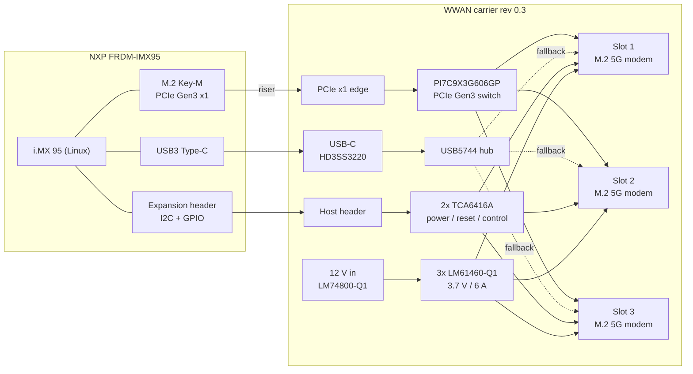
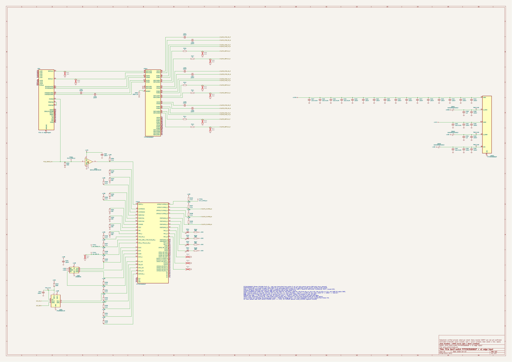
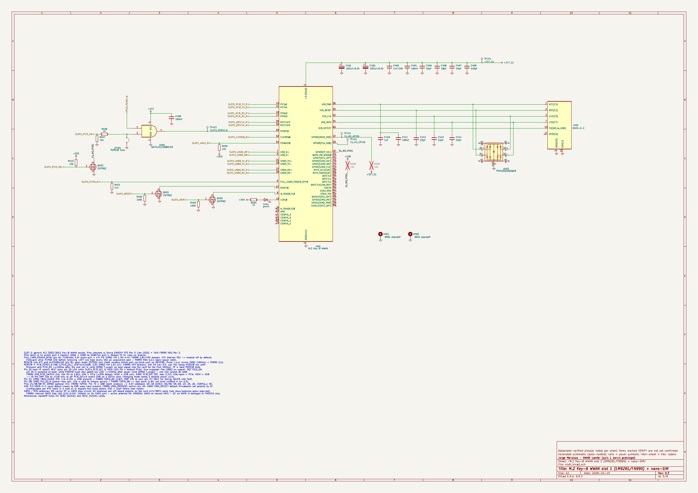
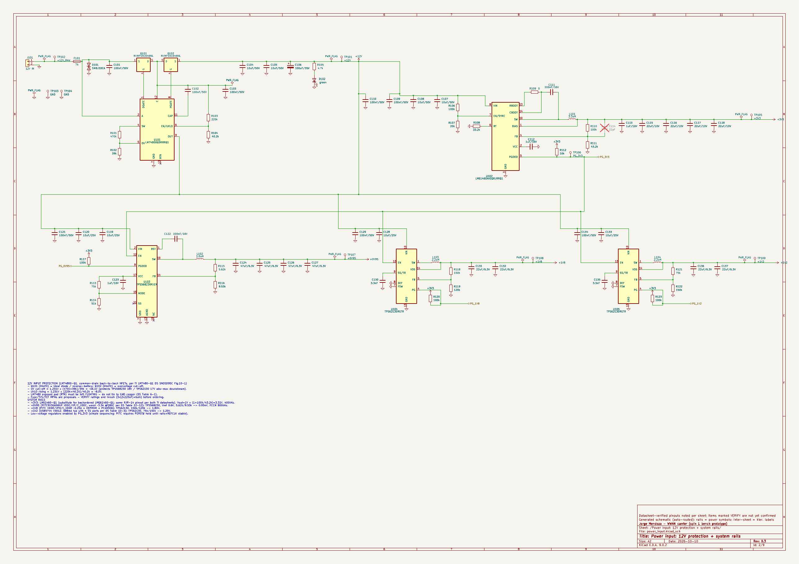

# Connectivity Module: triple-modem 5G WWAN carrier

A personal hardware project: a carrier board that puts **three M.2 5G modems behind a PCIe Gen3 packet switch**,
so one Linux host can run three cellular links at once and bond them. This repo has the schematic, the design
documents behind it, and the start of the bring-up software.

> **Status: personal project, pre-hardware.** Schematic rev 0.3 is complete and passes KiCad ERC
> (0 errors, 0 warnings). **No PCB layout yet and no boards have been fabricated.** Nothing has been measured
> on hardware. The firmware and Linux software are **scaffolding** (interfaces, specs and stubs), not working code.
> Open and unverified items are tracked in [docs/open-issues.md](docs/open-issues.md).

## Architecture (spin 1, bench prototype)

- **Host:** NXP FRDM-IMX95 dev board (i.MX 95, Linux), connected to the carrier through its M.2 Key-M PCIe Gen3 x1 port.
- **PCIe fan-out:** Diodes PI7C9X3G606GP PCIe Gen3 packet switch, one upstream port, three downstream ports to the slots.
- **Modem slots:** 3x vendor-neutral M.2 3052/3042 Key-B WWAN slots for pre-certified 5G cards
  (Sierra Wireless EM9291 or Telit FN990A28, both Qualcomm SDX65), each with its own nano-SIM.
- **USB fallback:** Microchip USB5744 USB 3 hub (with HD3SS3220 USB-C front end) gives every slot a second host path,
  so PCIe and USB latency can be compared.
- **Per-slot power:** 12 V input with LM74800-Q1 reverse/over-voltage protection; one TI LM61460-Q1 3.7 V / 6 A buck
  per slot, so each modem can be power-cycled on its own.
- **Control:** two TI TCA6416A I2C GPIO expanders drive each slot's power enable, FCPO#, RESET#, W_DISABLE#,
  PERST# gating and interface select, and read back power-good.

## Key design choices

- **PCIe switch over a USB hub as the main path:** all three links get the same data path, latency and driver,
  which makes it easier to tune a bonding scheduler. The USB hub stays as a per-slot fallback and an A/B comparison.
- **One buck per modem:** 5G cards draw peaks of several amps. Separate rails keep one modem's transients off the others,
  allow independent power cycling, and spread the heat.
- **Sequencing in hardware and software:** PERST# is held low by default with the expander in reset and released only after
  power-good. Interface select (pin 20) has its own control line because the card samples it at boot. Timings come from
  the module vendors' hardware guides ([docs/power-reset-sequencing.md](docs/power-reset-sequencing.md)).
- **Vendor-neutral slots:** a generic M.2 Key-B WWAN pinout with Sierra- and Telit-specific options left as do-not-populate parts.
- **Carry-over to a vehicle spin:** automotive-grade (AEC-Q) parts where practical, so the modem, PCIe and power pages can be reused.
- **Supply chain:** named manufacturer part numbers on every part in the BOM.
- **Generated, checked schematic:** the KiCad schematic is produced by a Python generator from pin tables taken from the datasheets,
  with netlist sanity checks (`hardware/generator/netcheck.py`). CI runs KiCad ERC and checks that the generated HW/SW interface
  docs match the netlist.

## Schematics and documents

- Schematic PDF: [hardware/wwan-carrier-schematic-rev0.3.pdf](hardware/wwan-carrier-schematic-rev0.3.pdf)
- KiCad 9 project (root + 8 sheets): [hardware/kicad/](hardware/kicad/)
- Previews:   
- BOM and ERC report: [hardware/wwan-carrier-bom.csv](hardware/wwan-carrier-bom.csv), [hardware/wwan-carrier-erc.rpt](hardware/wwan-carrier-erc.rpt)
- Architecture and parts trade-offs: [hardware/docs/](hardware/docs/)
- HW/SW interface (generated from the netlist): [docs/hw-sw-interface.md](docs/hw-sw-interface.md)
- Bring-up test plan (stages T0-T8): [docs/bringup-test-plan.md](docs/bringup-test-plan.md)

## Software and firmware (scaffolding)

- `software/dts/`: device-tree overlay skeleton for the i.MX 95. Not yet run on hardware.
- `software/tools/carrierctl.py`: control CLI for slot power and reset sequencing, with a `--dry-run` mode that prints every
  I2C write. Not yet run on hardware.
- `firmware/`: layout, interfaces and state-machine specs for a planned power-management MCU (rev 0.4). Stubs only; not compiled for a target.

## Status

| Area | State |
|---|---|
| Architecture, parts, budget | Done |
| Schematic rev 0.3 | Done: ERC 0/0, netlist checks pass; some part numbers and footprints still to verify |
| PCB layout | Not started |
| Boards | None fabricated |
| Linux bring-up software | Scaffolding, not run on hardware |
| MCU firmware | Specs and stubs only |
| Bonding | Requirements drafted; no implementation |

## Roadmap

1. Close the open schematic items (footprints for the M.2 socket and LM61460, switch and hub details).
2. PCB layout for spin 1, then fabricate and assemble.
3. Bench bring-up following the T0-T8 test plan: power rails, PCIe enumeration, one modem, then all three.
4. Linux bring-up: device-tree overlay, ModemManager, per-link routing.
5. Multi-link bonding experiments on live networks, measuring throughput, latency and failover.
6. Later: a vehicle-intent spin with a power-management MCU, CAN-FD, automotive Ethernet and GNSS.

## Regenerating

`tools/regen_hardware.sh` regenerates the schematic, netlist, ERC report, PDF, BOM and interface docs. See
[CONTRIBUTING.md](CONTRIBUTING.md).
