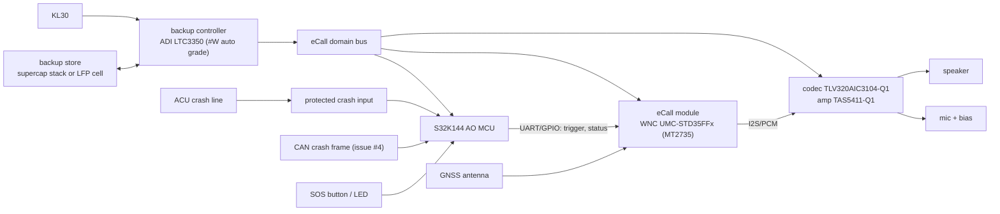

# eCall / NG eCall - design (issue #5)

> **Roadmap proposal (not implemented)**

Status: **design proposal for spin 2**; nothing on the rev 0.3 carrier. Marks: [V] verified (source), [U] unverified/assumption.
Constraints: pre-certified modules only, no Chinese-company parts (OI-26), MediaTek preferred.

## 1. Architecture decision: designated eCall module, not one of the 3 M.2 data slots

| Option | For | Against | Verdict |
|---|---|---|---|
| a) Use one M.2 slot (EM9291 / FN990A28) as eCall modem | no extra module | Neither card claims eCall/NG eCall or automotive qualification [V: no eCall/PCM text in EM92 PTS Rev 5; FN990 has I2S only as alternate functions on TGPIO pins 68/22/24/28 (FN990 HDG Rev 3), which rev 0.3 leaves NC/TP] ; laptop/industrial temp range; M.2 socket not crash-robust | **No** |
| b) **Dedicated solder-down automotive eCall module** in an "eCall domain" with backup power | Certified eCall stack, automotive temp/AEC-Q104, audio interfaces, survives on backup | +1 module, +antennas | **Yes (recommended)** |
| c) External TCU/eCall box over CAN/Ethernet | carrier unchanged | outside this personal design | only if an external box is supplied |

eCall module candidates (from issue #5 / parts-shortlist.md, unchanged): **primary WNC UMC-STD35FFx** (WNC, Taiwan / MediaTek
MT2735; product spec R1 lists 3GPP/EU CS eCall, EU/3GPP IMS (NG) eCall and ERA-GLONASS as "Supported"; I2S0/I2S2/PCM0; -40..85 °C,
eCall to 95 °C) [V: FCC-filed product spec; certification evidence U]. Fallback **Rolling Wireless RN93xx/RN94xx** (Qualcomm
SA522M/SA525M), ownership still an open decision. Excluded: Quectel AG5xx/AR588 and Fibocom/Favalon (PRC).

## 2. Audio (non-Chinese, automotive)

| Part | Function | Data | Mark |
|---|---|---|---|
| **TI TLV320AIC3104-Q1** | stereo codec, I2S/TDM, I2C control, mic bias, AGC | AEC-Q100 Grade 2 (-40..105 °C) | [V] TI product page / DS Rev D |
| **TI TAS5411-Q1** | mono Class-D amp | up to 8 W into 4 Ω, I2C load diagnostics (speaker open/short - useful for eCall self-test), 40 V load-dump tolerant | [V] TI TIDA-00724 eCall audio reference design |
| Newer alternative: TI TAC5312-Q1 + TAS5431-Q1 | codec + amp | TI TIDA-060048 reference design with schematics/layout | [V] TI reference design page; part data [U] |
| Microphone | automotive MEMS/electret per OEM | | [U] OEM-supplied, usually |

Reference: TI **TIDA-00724** "Automotive eCall audio subsystem reference design" (TLV320AIC3104-Q1 + TAS5411-Q1) [V].

## 3. Crash input and HMI

- **Hard-wired ACU crash line:** protected digital input (series R + TVS + RC, comparator/Schmitt to 3.3 V AO), 12 V/24 V tolerant,
  debounced and plausibility-checked by the MCU; second path = CAN crash frame (issue #4). Line format (level, PWM, pulse) is OEM
  specific [U].
- **SOS button** (manual eCall) + optional cancel; **status LED/telltale** driven by MCU with diagnostics (open/short).
- MCU triggers the module (AT/UART or GPIO per WNC guide [U]); the module owns MSD (EN 15722) and the call.

## 4. Backup power sizing

Requirement [V]: after loss of vehicle power, **5 min voice + 60 min registered/callback + 5 min voice** (UN R144 Annex 9 / EU
2017/79 backup-power test; summary per UNECE R144 amendment text and EUR-Lex). Verify against the exact clause before sign-off.

Assumptions [U] (replace with WNC datasheet / bench numbers):

| Load | Talk (W) | Idle/callback (W) |
|---|---|---|
| eCall module, VoLTE/NG eCall call, mid power | 2.3 (~0.6 A @3.8 V) | 0.11 (~30 mA @3.8 V, registered DRX) |
| Speaker amp, average speech at moderate level | 1.0 | 0 (muted) |
| Codec + mic | 0.05 | 0.005 |
| MCU (RUN) + SBC | 0.15 | 0.05 |
| GNSS (in module) | 0.05 | 0.02 |
| **Total** | **3.55 W** | **0.19 W** |

Energy: talk 2 x 300 s x 3.55 W = 2130 J; idle 3600 s x 0.19 W = 684 J; **sum 2.8 kJ (0.78 Wh)**.
With 85 % converter efficiency, 50 % end-of-life/cold derating and 20 % reserve: 2.8 kJ / 0.85 / 0.5 x 1.2 = **~7.9 kJ (2.2 Wh)**.

| Store | Sizing | Comment |
|---|---|---|
| Supercap stack, 4S 2.7 V (10.8 V max) discharged to 4 V via LTC3350 boost/backup path | usable E = 1/2 C (10.8^2 - 4^2) = 50.3 C -> **C_stack ~ 157 F** (each cell ~630 F) | Very large/heavy for 2.2 Wh; cold performance good, lifetime good. Feasible only if the talk assumptions shrink [calc] |
| **LiFePO4 1S (3.2 V)** | 2.2 Wh -> ~**0.7 Ah**; pick 1.0-1.5 Ah automotive-rated cell | Recommended; needs low-temp charge inhibit, heating or derating < -20 °C [U]; non-PRC cell maker required (e.g. VARTA DE, Saft FR - **VERIFY** automotive backup offerings) |
| NiMH (traditional eCall backup) | 3-cell 3.6 V, ~0.6-1 Ah | Proven in eCall, wide temp; slower charge [U] |

Backup controller: **ADI LTC3350** (1-4 series supercaps, monitors capacitance/ESR, ideal-diode backup; automotive "#W" AEC-Q100
versions) [V: analog.com]. For a battery store, a TI/ADI automotive charger + ideal-diode OR (LM74700-Q1 class [U]) replaces it.

## 5. Standards checklist (verify current versions before design freeze)

| Item | Scope | Status |
|---|---|---|
| Regulation (EU) 2015/758 + Delegated Reg. (EU) 2017/79 (technical reqs, incl. backup power, crash resistance) | EU type approval | [V: 2017/79 OJ L 12/44] |
| Delegated Reg. (EU) 2024/1180 (eCall standards update, move to IMS) | EU | [U] link in issue |
| Delegated Reg. (EU) 2025/1871 (EN 17184:2024 / EN 17240:2024 NG eCall) | EU | [U] |
| UN R144 (AECD/AECS) incl. Annex 9 backup supply | UNECE | [V] R144 amend. text |
| EN 15722:2020 MSD | data | [U] |
| EN 16072:2022 operating requirements | function | [U] |
| EN 16062:2023 / EN 16454:2023 CS eCall HLAP / conformance | legacy CS | [U] |
| EN 17184:2024 / EN 17240:2024 NG eCall HLAP / conformance | IMS eCall | [U] |
| ERA-GLONASS GOST 33464 / 33465 | RU/EAEU | [U] - only if region in scope |
| US/CA: no eCall mandate (NG911 / OEM private emergency services) | NA | [U] |

## 6. Schematic impact (spin 2)

New sheets: `ecall_module` (LGA footprint + antennas + SIM/eSIM), `audio` (codec, amp, mic bias, speaker diagnostics),
`backup_power` (LTC3350 or battery charger, store, OR-ing), `crash_io` (ACU input, SOS button, LED). The AO MCU (power-mcu.md)
becomes mandatory and owns the eCall power domain.
