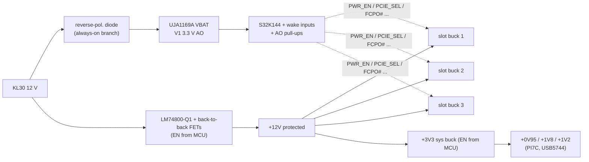
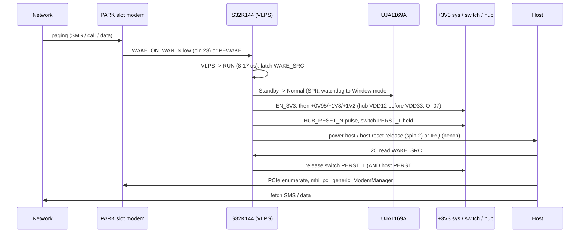

# Low-power PARK mode - design (issue #3)

Status: **design proposal** (rev 0.3 schematic unchanged). Marks: [V] datasheet/vendor value (source given), [U] assumption.
Goal: parked vehicle on the 12 V battery, **one configurable slot** kept registered in idle/DRX for paging (SMS / call /
network-initiated data), the other two slots and all PCIe/USB infrastructure **off**, host off.

## 1. Power states

| State | KL15 | Host | Switch/hub (+0V95/+1V8/+1V2/+3V3 sys) | Slots | MCU | SBC (UJA1169A) |
|---|---|---|---|---|---|---|
| RUN | on | on | on | 1-3 per config | RUN | Normal |
| REDUCED | on | on | on | 1-2 | RUN | Normal |
| **PARK** | off | off | **off** | **1 (always-on slot) idle, others off** | VLPS | **Standby** (V1 on) |
| OFF | off | off | off | all off | unpowered | **Sleep** (V1 off) |

## 2. Power-domain partition

- **AO domain** (always on): SBC + MCU + wake-input pull-ups + slot sideband buffers' AO side. Fed **before** the LM74800 via its own
  reverse-polarity diode so OFF can disable the LM74800 too.
- **Slot domains** (3x): unchanged per-slot LM61460 bucks; the configured PARK slot stays on.
- **Infrastructure domain**: +3V3 system buck -> +0V95/+1V8/+1V2 (switch, hub, expanders). Today its EN is tied on (PG chain from
  +12V); PARK needs **EN_3V3 under MCU control**.
- **Isolation**: when infrastructure is off, slot-side PCIe sideband (PERST#, CLKREQ#, PEWAKE#), USB and the +3V3 LED pull-ups must not
  back-feed the powered PARK slot or the unpowered slots (OI-30). PERST# for the PARK slot is held low by the AND gate whose supply
  goes away -> needs a **PD on the slot side** and an AO-powered gate, or an analog isolator [U: choose part].

## 3. Sleep-current budget (12 V input, 25 °C, typical)

| Block | Condition | Current | Source |
|---|---|---|---|
| UJA1169A SBC | Standby, V1 on, CAN offline, V2 off | 91 µA | [V] UJA1169A DS Rev 1 Table 53 |
| UJA1169A CAN offline bias (bus active) | while vehicle CAN still running | +38-55 µA | [V] same table |
| S32K144 MCU | VLPS, 25 °C | 29.8 µA (256 µA @105 °C) | [V] NXP S32K deep-dive deck |
| TJA1465 (2nd CAN, optional, issue #4) | Sleep, Tvj < 85 °C | <= 3 µA + VIO <= 2 µA | [V] TJA1465 DS Rev 1.0 Table 49 |
| LM74800-Q1 ideal-diode front end | enabled (needed to feed the PARK slot) | 413 µA typ / 495 max **@24 V**; 12 V value from curve | [V] TI DS (24 V), [U] 12 V |
| Slot bucks x2 (off slots) | EN = 0 | 2 x 0.6 µA | [V] LM61460-Q1 DS ISD |
| +3V3 system buck | EN = 0 | 0.6 µA | [V] LM61460-Q1 DS |
| +0V95 / +1V8 / +1V2 regulators | input from +3V3 (off) | ~0 | - |
| PARK slot buck | no-load Iq (auto/PFM mode) | 7 µA | [V] LM61460-Q1 DS (13.5 V in, 3.3 V out) - **only if the ordered variant is auto-mode, not FPWM** [U] |
| Misc pull-ups / leakage / dividers | VBAT/KL15 sense dividers etc. | ~50 µA | [U] estimate |
| **Carrier subtotal (no modem)** | | **~0.65 mA** | sum (LM74800 at 24 V value) |
| Modem: **Sierra EM9291** | Standby, 5G DRX 1.28 s, **host interface in low-power state** (PCIe): 4.2 mA @3.3 V | ~1.6 mA at 12 V | [V] EM92 PTS Rev 5 Table 4-2; conversion [U] 3.74 V, 80 % light-load eff. |
| Modem: **Telit FN990A28** | Standby (PSMWDISACFG=1, W_DISABLE_N low, USB disconnected): < 5 mA | < ~2.0 mA at 12 V | [V] FN990 HDG Rev 3 power table; conversion [U] |
| **PARK total** | | **~2.3-2.7 mA at 12 V** (~28-32 mW) | |
| **OFF total** | SBC Sleep 65 µA + LM74800 shutdown 2.87 µA + bucks 4 x 0.6 µA + leakage | **~0.1 mA** | [V] parts / [U] leakage |

Caveats: (1) EM9291's 4.2 mA is with the host interface *in a low-power state*; with the link operational it is 59.9 mA [V].
Whether the card stays registered with **PERST# asserted and REFCLK gone** (switch off) is **not stated** in either guide -> bench
test, vendor FAE (also OI-14 area). Fallback: keep the switch powered and the link in L1.2 (adds PI7C + REFCLK current [U]).
(2) LM74800 Iq dominates the carrier share -> option: a lower-Iq reverse-protection path for PARK [U: part TBD].
(3) Battery drain: at 2.5 mA a 60 Ah battery loses 1 % per ~10 days; I still need to set the actual limit.

## 4. Wake flow

Target "wake to data path up" time is still an open decision; host boot dominates.

## 5. Modem-side configuration (to verify per card)

- EM9291: WAKE_ON_WAN_N is open-collector, host PU 5k-100k to 3.3 V, < 100 ns rise; host support optional; events configured by AT [V: PTS 2.6.1; events U].
- FN990: WAKE_ON_WAN_N 1.8 V output with default PU [V]; standby via `AT#PSMWDISACFG=1` + W_DISABLE_N low per HDG power table [V: table; exact command syntax U].
- Both: SMS wake is cheap; network-initiated IP wake needs keep-alive/NAT handling and costs current [U].

## 6. Required schematic changes (next revision)

1. Always-on branch: KL30 -> reverse diode -> UJA1169A -> 3.3 V AO; MCU per power-mcu.md.
2. LM74800 EN and +3V3 system buck EN under MCU control (today: always on / PG chain).
3. PERST#, CLKREQ#, PEWAKE#, W_DISABLE#, FCPO#, RESET# gates per slot powered from AO 3.3 V (not +3V3 sys) so the PARK slot keeps defined levels with infrastructure off; slot-side PDs.
4. LED1# anode pull-up from slot rail instead of +3V3 (OI-30).
5. Pin 23 WAKE_ON_WAN_N per slot -> MCU via PU to AO 3.3 V (EM92 OC) and a 1.8 V-compatible input (FN990), e.g. TI SN74LXC1T45-Q1 class level shifter [U].
6. Confirm LM61460 ordering variant is auto-mode (PFM) for the slot bucks, or add a light-load path [U].
7. Test points for PARK current measurement (shunt jumper in KL30 AO branch and in +12V protected).
