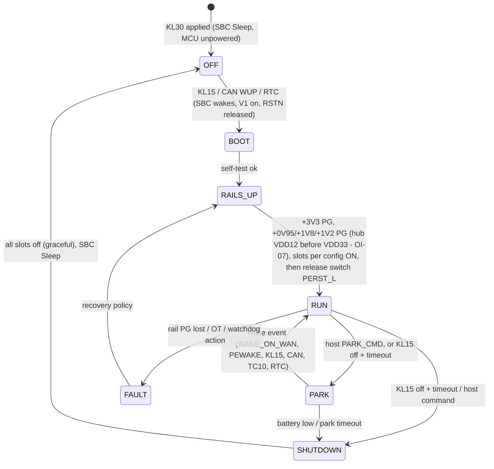
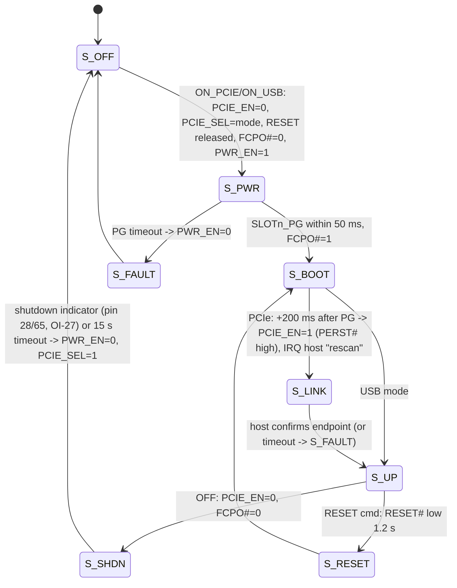
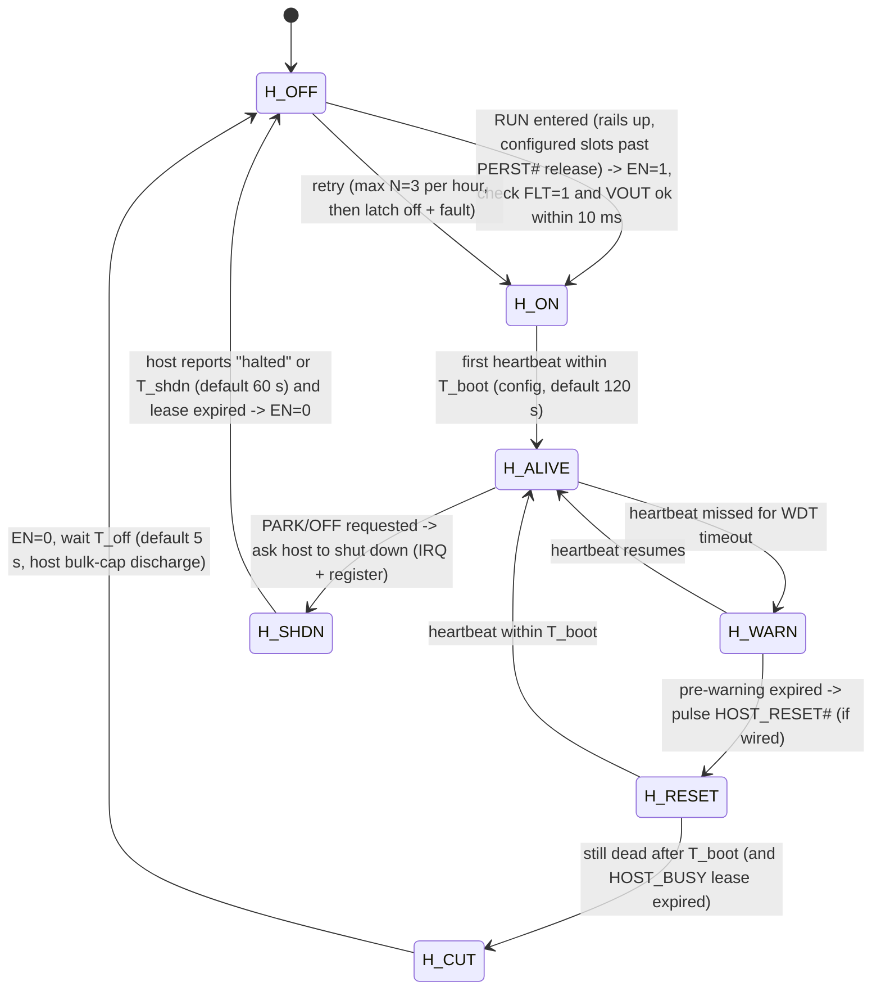

# Power-management MCU - design (issue #1)

> **Roadmap proposal (not implemented)**

Status: **design for carrier rev 0.4** (MCU goes directly on the next carrier revision; no daughterboard). Rev 0.3 on `main` is
unchanged. Marks: **[V]** verified on the linked vendor/distributor page or datasheet (2026-10-10), **[U]** unverified / assumption.
Supply-chain rule (OI-26): no parts from Chinese companies. MediaTek has no automotive MCU line, so the MCU is NXP (NL).

**Decisions (2026-10-10, issue #1):** (1) functional-safety target **ASIL-B** -> S32K3 family with lockstep core + HSE;
(2) **secure boot required** (HSE-based chain, signed A/B firmware); (3) **full host power control** by the MCU (switch the host
supply, watchdog escalation reset -> power cut, flash-write handshake); (4) firmware lives **in this repo** (`firmware/`);
(5) MCU **directly on carrier rev 0.4**.

## 1. Selection

### 1.1 MCU - primary: NXP S32K344 (lockstep Cortex-M7, HSE-B), 172-pin

| Item | Value | Mark / source |
|---|---|---|
| Orderable P/N | **S32K344EHT1MPBST** - S32K344, 2x Cortex-M7 **lockstep** 160 MHz, 4 MB flash, 512 KB RAM, **HSE_B**, 172 HDQFP/MaxQFP 16x16 mm, 0.65 mm pitch, tray | [V] nxp.com part page |
| Safety | NXP: "ASIL Certification: up to ASIL D"; distributor screening "AEC-Q100; ISO 26262 ASIL D". Safety mechanisms: lockstep core, ECC on flash/RAM, FCCU, SWT, CMU clock monitors, voltage monitors, STCU2 (MBIST/LBIST) | [V] nxp.com, findchips; mechanism list from S32K3xx DS block diagram |
| Qualification | AEC-Q100 **grade 1** (-40..125 °C ambient) | [V] nxp.com |
| Security | HSE_B (AES-256, RSA-4096, ECC-521, TRNG, secure boot, key store, firmware upgradable), "FOTA: Yes" (A/B swap, read-while-write) | [V] nxp.com / S32K3xx DS |
| I/O | **142 GPIO** (172-pin) vs **~84 needed** (sec. 4) -> room for ASIL-B read-back pins | [V] nxp.com |
| Comms | 2x LPI2C, 6x LPSPI, 16x LPUART, 6x FlexCAN-FD, 100M Ethernet MAC, FlexIO | [V] nxp.com |
| Supply | 2.97-5.5 V (run at 3.3 V from SBC V1) | [V] findchips parametric |
| Price / stock | NXP direct $9.61-11.36, 652 in stock, 16-week lead; budgetary 1K $8.56; Farnell 176 pcs ~$16.52 @1 (2026-10-10 snapshot; NXP page shows 39-week factory lead) | [V] findchips / nxp.com |
| Note | Distributors list **COO: China** (NXP assembly/test site). The supply-chain rule is about the vendor's HQ (NXP = NL), but see OI-26 (f) / **OI-38** | [V] Farnell listing |

### 1.2 Alternatives (same S32K3 lockstep + HSE-B family, software-compatible)

| Part | Package / I/O | Flash/RAM | Price / stock | Fit |
|---|---|---|---|---|
| **S32K341EHT0MPAST** (lockstep, ASIL D capable, AEC-Q100) | 100 HDQFP 10x10, **~80-85 GPIO** (S32K342 100-pin page: 85) | 1 MB / 256 KB | NXP $6.30-7.45, 1,966 in stock; Arrow $8.52 | Cost-down; **pin budget (~84) does not fit with read-backs** - only if read-backs are cut. [V] findchips / nxp.com (GPIO count from the S32K342EHT0MPAST page) |
| S32K342EHT0MPAST (lockstep) | 100 HDQFP, 85 GPIO | 2 MB / 256 KB | [U] | same pin problem |
| S32K344EHT1MMMST | 257 MAPBGA, 218 GPIO | 4 MB / 512 KB | budgetary $9.01 @1K; $14.26 @1 | BGA - only if the board goes 6+ layers anyway |
| S32K312 / S32K314 (non-lockstep) | - | - | - | **No**: ASIL-B MCU mechanisms want lockstep (or a second checker) |

Previous proposal S32K144 is **dropped** (no lockstep, CSEc only, no native A/B FOTA).

### 1.3 Always-on supply / SBC - primary: NXP UJA1169A (3.3 V V1, partial networking)

| Item | Value | Mark |
|---|---|---|
| Part | **UJA1169ATK/F/3** (V1 = 3.3 V, 250 mA; V2 = 5 V for CAN; /F = ISO 11898-6 partial networking) - exact reel suffix **[U]** | [V] NXP fact sheet / DS variant table |
| Qualification | AEC-Q100 Rev-G; HVSON20 3.5 x 5.5 mm | [V] UJA1169A fact sheet |
| Battery current | **Standby (V1 on, CAN offline, V2 off): 91 µA typ**; Sleep (V1 off): 65 µA typ; +38-55 µA CAN offline bias; +0.4-0.65 mA with PN active; VBAT 7-18 V, -40..85 °C | [V] UJA1169A DS Rev 1, Table 53 |
| Watchdog | Window / Timeout / Autonomous, independent clock | [V] |
| Wake | CAN (WUP or selective WUF on /F), local WAKE pin (KL15) | [V] |
| Ownership | NXP (Netherlands) - fine. **Not Nexperia.** | - |

PARK uses **Standby** (V1 stays on for the MCU in its STANDBY mode); OFF uses **Sleep** (V1 off, wake by KL15/CAN only).

Alternatives: TI TCAN1145-Q1 / TCAN1146-Q1 SBC-style CAN transceivers with partial networking [U: check LDO capability];
Infineon TLE9461-3ES (Lite SBC with CAN PN) [U]. A plain wide-Vin LDO (e.g. TI TPS7B81-Q1, ~3 µA Iq [U]) + separate TJA1465 is the
lowest-current option if CAN wake is owned elsewhere (see issue #4).

## 2. Host interface

**Choice: I2C target on the existing J801 bus + open-drain IRQ (EXP_INT_N re-used), plus UART for firmware update/console.**

- Keeps the FRDM header and `carrierctl` model (register reads/writes instead of TCA6416A registers). Host traffic wakes the MCU: S32K3 has up to 60 wake-capable pins [V: S32K3xx DS]; the I2C SDA/SCL (or IRQ) pin is routed to a WKPU input so a host transaction wakes it (S32K3 LPI2C address-match wake from STANDBY [U] - otherwise the host pulses a wake GPIO first).
- Address: **0x42** proposed (free on the bus: TCA6416A 0x20/0x21, USB5744 0x2D, PI7C 0x6F/0x68 per OI-04/05) [U: confirm no clash on the FRDM bus].
- SPI (spin 2) is optional; the register map is transport-independent.
- Bench fallback: U801/U802 footprints stay; 0R option resistors select "expander drives slot nets" or "MCU drives slot nets" (never both).

### 2.1 Register map (v0 draft)

| Addr | Name | Access | Content |
|---|---|---|---|
| 0x00 | ID | R | 0x5C, fw major/minor at 0x01/0x02 |
| 0x03 | STATE | R | carrier state (sec. 3.1) |
| 0x04 | SLOT_STATE[1..3] | R | per-slot state (sec. 3.2), 3 bytes |
| 0x08 | SLOT_CMD | W | {slot, cmd = ON_PCIE / ON_USB / OFF / HARD_OFF / RESET / RF_OFF / RF_ON} |
| 0x09 | RAIL_STATUS | R | PG bits (3V3, 0V95, 1V8, 1V2, slot PGs) |
| 0x0A | WAKE_SRC | R/clear | last wake source bitmap (KL15, CAN, slotN WAKE_ON_WAN, slotN PEWAKE, RTC, ETH TC10) |
| 0x0B | IRQ_STATUS / 0x0C IRQ_MASK | R/W | slot state change, fault, wake, watchdog pre-expiry |
| 0x10 | WDT_CFG | R/W | host heartbeat timeout (s), action (signal only / reset host / power-cycle host) |
| 0x11 | WDT_KICK | W | heartbeat |
| 0x18 | PARK_CFG | R/W | always-on slot (1/2/3), wake-source enable mask (NVM-backed) |
| 0x19 | PARK_CMD | W | enter PARK / OFF |
| 0x20.. | TIMING[] | R/W | per-slot timing table (module profile: PERST delay, shutdown timeout, reset pulse) - NVM-backed |
| 0x40.. | FWUPD | W | bootloader entry key |
| 0x50 | HOST_PWR_STATE | R | host power state (sec. 6.2) |
| 0x51 | HOST_PWR_CMD | W | {POWER_ON, GRACEFUL_OFF, REBOOT} - authenticated host request only via key word |
| 0x52 | HOST_BUSY | R/W | **flash-write / update-in-progress lease**: host writes lease seconds (max 600); MCU defers any non-emergency power cut while > 0 (sec. 6.3) |
| 0x53 | HOST_I_MEAS | R | host supply current (mA) from switch current sense |
| 0x58 | SAFETY_STATUS | R | FCCU fault flags, last safe-state reason |

## 3. Firmware architecture

Code in this repo under [`firmware/`](../../firmware/README.md) (skeleton). NXP RTD (MCAL) drivers + a cooperative scheduler (10 ms /
100 ms tasks) or AUTOSAR-lite; a safety-certified RTOS (e.g. SAFERTOS) only if needed [U]. Modules: `rails`, `slot[3]`, `hostpwr` (sec. 6),
`hostif` (I2C target + IRQ), `wdt`, `wake`, `safety` (FCCU, read-backs, self-test), `nvm` (D-flash), `boot` (bootloader, sec. 5). All timings come from a **per-slot module
profile** (EM9291 / FN990A28 / future NTN card) - the rev 0.3 values from `docs/power-reset-sequencing.md` are the defaults.

### 3.1 Carrier state machine

### 3.2 Slot state machine (per slot, module-profile timings)

### 3.3 Watchdogs

- SBC watchdog (Window mode in RUN, Timeout in PARK) kicked by MCU main loop -> resets the MCU only.
- Host watchdog: host writes WDT_KICK; on timeout the MCU escalates per sec. 6.3 (pre-warning IRQ -> HOST_RESET# -> power cut,
  respecting the HOST_BUSY lease). On the FRDM bench the host supply is not switched by the carrier -> "signal only" profile.
- MCU software watchdog (SWT) + FCCU for internal faults.

## 4. Pin budget (every current expander/sideband signal -> MCU)

| Signal (rev 0.3 net) | Today | MCU pin type | Count | Notes |
|---|---|---|---|---|
| SLOT1..3_PWR_EN | U801 out | GPIO out | 3 | keep 100k PD (slot off while MCU in reset) |
| SLOT1..3_FCPO_N | U801 out | GPIO out | 3 | 47k PD stays |
| SLOT1..3_RESET | U801 out | GPIO out | 3 | drives 2N7002 gate, PD stays |
| SLOT1..3_WDIS | U801 out | GPIO out | 3 | |
| SLOT1..3_PCIE_EN | U801 out | GPIO out | 3 | PD default (PERST# held) |
| SLOT1..3_PCIE_SEL | U802 out | GPIO out | 3 | 10k PU default (PCIe) |
| HUB_RESET_N | U801 out | GPIO out | 1 | |
| SLOT1..3_PG | U802 in | GPIO in (wake-capable) | 3 | |
| SLOT1..3_WAKE_N (PEWAKE#) | U802 in | GPIO in, IRQ/wake | 3 | |
| PG_3V3 / PG_0V95 / PG_1V8 / PG_1V2 | U802 in | GPIO in | 4 | |
| USER_LED1/2 | U802 out | GPIO out | 2 | |
| **New:** rail EN for +3V3 / +0V95 / +1V8 / +1V2 | hard-wired PG chain | GPIO out | 4 | fixes OI-07 (hub VDD12 before VDD33) |
| **New:** SLOT1..3 WAKE_ON_WAN_N (pin 23) | NC | GPIO in, wake | 3 | 1.8 V (FN990) / OC (EM92): level-shift or 1.8 V-tolerant input + PU to always-on 3.3 V (OI-34) |
| **New:** SLOT1..3 shutdown indicator (EM92 pin 28 / FN990 pin 65) | TP only | GPIO in | 3 | via 1.8 V->3.3 V buffer (OI-27) |
| **New:** switch PERST_L gate (AND with host PERST#) | - | GPIO out | 1 | OI-12 |
| Host I2C target SCL/SDA | J801 | LPI2C0 | 2 | wake on address match |
| Host IRQ (EXP_INT_N) | U801/U802 INT | GPIO out OD | 1 | |
| Host reset out (optional) | - | GPIO out OD | 1 | watchdog action |
| SBC SPI (SCK, SDI, SDO, SCSN) | - | LPSPI | 4 | |
| SBC RSTN, SBC INTN/limp | - | GPIO in | 2 | |
| CAN-FD TXD/RXD (SBC CAN) | - | FlexCAN0 | 2 | |
| 2nd CAN (TJA1465, issue #4) TXD/RXD + SPI CS + INH sense | - | FlexCAN1 + GPIO | 4 | optional |
| KL15 sense | - | ADC/GPIO | 1 | also on SBC WAKE |
| VBAT sense | - | ADC | 1 | battery-low PARK exit |
| Board temp (NTC) | - | ADC | 2 | |
| Ethernet TC10 wake / INH from PHYs (issue #4) | - | GPIO in | 2 | optional |
| eCall: crash input, button, LED (issue #5) | - | GPIO | 3 | optional |
| 1PPS capture (OI-37, optional) | - | FTM input capture | 1 | |
| Debug UART (bootloader/console) | - | LPUART | 2 | |
| SWD (SWDIO, SWCLK) + RESET_b | - | dedicated | 3 | |
| **New (rev 0.4 decisions):** host supply high-side switch EN | - | GPIO out | 1 | TPS1HC30-Q1 EN (sec. 6) |
| Host switch FLT (open-drain status) | - | GPIO in | 1 | |
| Host switch current sense SNS | - | ADC | 1 | over-current / sizing telemetry |
| Host output voltage read-back (divider) | - | ADC | 1 | ASIL-B: verify switch state independent of FLT |
| Host power-good / host "alive" (heartbeat GPIO, optional) | - | GPIO in | 1 | second channel next to I2C heartbeat |
| HOST_BUSY hardware line (optional, host GPIO) | - | GPIO in | 1 | flash-write handshake backup if I2C is down |
| ASIL-B read-back of safety-relevant outputs (slot PWR_EN x3, host switch EN, rail EN x4 via ADC/GPIO) | - | GPIO/ADC in | 8 | detect stuck outputs (sec. 7) |
| SBC FCCU/EOUT error out -> SBC / fail-safe pin | - | dedicated | 1 | FCCU EOUT to SBC LIMP/fail input [U] |
| **Total** | | | **~88** (incl. optional) | S32K344 172-pin: **142 GPIO** [V] -> ~54 spare. 100-pin S32K341/342 (85 GPIO) does **not** fit with read-backs |

## 5. Secure boot, key provisioning and signed A/B firmware (HSE-B)

Chain of trust:
1. **HSE firmware** (NXP-signed, installed into the HSE secure flash) is the root. Device lifecycle advanced CUST_DEL -> **OEM_PROD** after provisioning, then **IN_FIELD** [U: exact S32K3 lifecycle names per HSE FW reference manual, NDA].
2. **Secure Boot Assisted (SMR/CR tables)**: HSE verifies the **bootloader** (Secure Memory Region) with an ECDSA P-256 (or RSA) public key held in the HSE key catalog before releasing the M7 core from reset [U: HSE "SMR/CR" naming, NXP HSE docs are NDA].
3. **Bootloader** (in repo, `firmware/boot/`) verifies the application image header (version, rollback counter, ECDSA signature over SHA-256) via HSE services, selects slot A or B, then jumps.
4. **Application** runs; anti-rollback via HSE monotonic counter.

Flash layout (4 MB P-flash, S32K344 has read-while-write across blocks [U: block map]):

| Region | Size | Content |
|---|---|---|
| Bootloader | 128 KB | SMR-verified by HSE |
| Slot A | 1.5 MB | application image + header |
| Slot B | 1.5 MB | application image + header |
| Config / NVM | D-flash 128 KB | slot table, timing profiles, PARK config (CRC + version) |

Update flow (host -> MCU over UART/I2C, `carrierctl fw-update`): write inactive slot -> HSE verify signature -> mark "pending" ->
reboot -> bootloader boots pending with boot counter -> app confirms after self-test -> "confirmed"; 3 failed boots -> roll back.
While the host streams an MCU image it holds the HOST_BUSY lease (sec. 6.3), so the MCU does not cut host power mid-transfer.

Key provisioning (factory station, documented in `firmware/docs/provisioning.md`):
- Generate the OEM signing key pair in an HSM (offline); only the **public** key and a key-catalog config go to production.
- Station programs HSE firmware, key catalog, SMR/CR config, bootloader, app A; advances lifecycle; locks debug (SWD password/disable) [U: exact debug-lock mechanism].
- Per-device keys (e.g. host-link authentication key) derived/injected and recorded per serial number.
- **No private keys in this repo or in CI** (CI builds unsigned dev images; signing is a separate offline step).

## 6. Host power control

### 6.1 Switch selection

| Part | Data | Use | Mark |
|---|---|---|---|
| **TI TPS1HC30-Q1** (primary) | single-channel 12 V smart high-side switch, **30 mΩ typ, 5 A**, adjustable current limit **1.2-12 A** (RILIM, ±15 % at 3.5 A), current-sense output ±6 % at 1 A, open-drain fault, standby **2.5 µA** at 85 °C, 3-28 V, AEC-Q100 grade 1, ISO 7637-2 / ISO 16750-2 transient certified, TI "Functional Safety-Capable", 14-pin PWP | hosts up to ~5 A at 12 V (~60 W); limit set ~1.5x host peak to tame the host's input-capacitor inrush | [V] TI DS Rev A / product page; orderable suffix [U] |
| TI TPS1HC100-Q1 | 100 mΩ, 2.5 A, limit 0.63-6.9 A, standby < 0.5 µA | small hosts (<= ~25 W) | [V] TI |
| Infineon **BTS7008-1EPP** (PROFET+2 12V) | 8.8 mΩ typ, 11 A nominal (TA 85 °C), overload trip >= 69 A, proportional current sense, AEC-Q100 grade 1, "ISO 26262-ready" | hosts > 5 A; needs a fuse/eFuse in series because its trip level is far above a small host's rating | [V] Infineon DS / part page |
| Infineon BTS7004-1EPP | 4.4 mΩ, 15 A nominal | large hosts | [V] Infineon |

Default: **TPS1HC30-Q1** on +12V protected (after LM74800) -> host connector power pins (host-interface.md option A). The
host-candidate current decides the final part (see open inputs).

### 6.2 Host power sequencing

Power-up order: always-on MCU/SBC -> +3V3 sys / switch / hub -> slots (configured) -> **host** -> MCU releases switch PERST_L
after host signals ready (or immediately on hosts that hot-plug). Power-down: slots gracefully (FCPO#, shutdown indicator) ->
host graceful -> host EN=0 -> infrastructure off.

### 6.3 Watchdog escalation and the flash-write handshake

- Escalation ladder: **IRQ pre-warning -> HOST_RESET# pulse -> power cut -> retry (max 3/h) -> latch off**. Each step logged in NVM.
- **No unexpected power cut during host flash writes:** the host takes a **HOST_BUSY lease** (register 0x52, seconds, max 600, and
  optionally the HOST_BUSY GPIO) before any eMMC/flash update or filesystem-critical operation and renews it. While a lease is
  active the MCU **defers watchdog power cuts and graceful-off cuts** until the lease expires.
- Lease cannot block **safety/protection cuts**: over-current (switch FLT / current limit), battery under-voltage (crank/brown-out),
  over-temperature, and crash/eCall power-domain reallocation always win.
- A hung host cannot hold power forever: the lease is bounded (max 600 s, not renewable without heartbeat).
- Host software: `carrierctl host-busy <s>` / systemd hooks around `swupdate`/`rauc` installs [U: host update tool].

### 6.4 Current sizing (to be confirmed per host)

| Host candidate | Supply | Estimated input power | Current @12 V | Switch | Mark |
|---|---|---|---|---|---|
| FRDM-IMX95 (bench) | board's own supply (USB-C PD / DC jack) | n/a | n/a | not switched on rev 0.4 bench, signal-only | [U] |
| MCM-iMX95 SoM on custom carrier | 12 V via carrier | ~5-10 W | ~0.4-0.9 A | TPS1HC30-Q1, limit ~2 A | [U] estimate |
| S32G274A / S32G3 board | 12 V | ~10-25 W | ~0.9-2.1 A | TPS1HC30-Q1, limit ~3.5 A | [U] estimate |
| LS1028A / IPQ9574 router board | 12 V | ~15-40 W | ~1.3-3.4 A | TPS1HC30-Q1 (limit ~5 A) or BTS7008-1EPP + fuse | [U] estimate |

Inrush: host input capacitance x dV/dt must stay below the set current limit; TPS1HC30-Q1 limits and thermally regulates
during charging [V: DS "inrush current control"], verify the host's bulk capacitance.

## 7. Safety concept outline (ASIL-B, ISO 26262) - placeholder for the full safety case

Item definition (draft): "carrier power-management function: supplies and sequences WWAN modules and the host, provides wake,
watchdog and host power control". Hazards come mainly from the vehicle-level functions that depend on connectivity (e.g. eCall, issue #5)
and from **unintended loss of host/eCall supply** or **unintended energisation** (thermal events).

| ID | Safety goal (draft) | ASIL (decided: B, to be confirmed by HARA) | Safe state |
|---|---|---|---|
| SG-1 | Avoid unintended loss of power to the host / eCall domain while the vehicle function requires it | B | supply ON, degraded (watchdog actions limited to reset) |
| SG-2 | Avoid continued supply into a short / over-current (thermal event, harness damage) | B | affected output OFF, latched, fault reported |
| SG-3 | Avoid power removal from the host during critical non-volatile writes unless SG-2 requires it | QM (B if HARA links it to SG-1) | supply held until lease expiry |

ASIL decomposition notes:
- Output switching: MCU decision (ASIL-B(B) on S32K344 lockstep) + **independent hardware protection** in the switch (current limit, thermal shutdown) -> SG-2 is covered by the switch even with MCU failure (decomposition **B(B) = A(B) + QM-hardware-protection** is *not* claimed until the FMEDA shows the switch diagnostics coverage) [U].
- SBC watchdog (independent clock) supervises the MCU; FCCU EOUT drives the SBC fail input -> on MCU fault the SBC forces reset/limp; outputs default to safe state through hardware pull-downs (slot EN off, host EN **on**? see SG-1 vs SG-2 conflict below).
- **Default of host EN on MCU reset is a safety decision:** SG-1 prefers "host stays powered", SG-2 prefers "off". Proposal: host EN driven through a latch/hold circuit that keeps the last state during MCU reset (< 100 ms) and falls to OFF only on SBC limp/fail [U: circuit]. **To be decided in the HARA.**

Technical safety requirements (placeholders): TSR-1 read back every safety-relevant output within 10 ms; TSR-2 host switch
FLT + VOUT plausibility check every 10 ms; TSR-3 MCU self-test (STCU2 LBIST/MBIST) at startup; TSR-4 SWT + SBC window watchdog;
TSR-5 NVM configuration protected by CRC and version; TSR-6 safe-state transition time <= TBD ms.

FMEA / FMEDA: `docs/safety/` placeholders to be created with the hardware design (rev 0.4): DFMEA of the power path, FMEDA of
the MCU + switch + SBC (single-point / latent fault metrics for ASIL-B: SPFM >= 90 %, LFM >= 60 % per ISO 26262-5 [U: commonly cited ISO 26262-5
targets - verify against the standard]).

Tooling/process: MISRA C:2012 for firmware, NXP RTD (AUTOSAR MCAL) + SAF (Safety Software Framework) as ASIL-capable base
software [U: licence terms], requirements traceability SG -> TSR -> SW/HW requirements in repo.

## 8. Schematic impact (carrier rev 0.4)

control sheet: S32K344 (172 HDQFP) + UJA1169ATK/F/3 + SWD/JTAG + 0R options vs U801/U802 (bench fallback); host power:
TPS1HC30-Q1 + ILIM resistor + SNS resistor + output read-back divider + host connector power pins; power_input: rail ENs from MCU,
always-on branch; slots: pin 23 and pin 28/65 buffers; pcie_switch: PERST_L AND gate; FCCU EOUT -> SBC.

## 9. Remaining open points (see issue #1 comment)

Host candidate and its supply current (switch sizing), HOST_RESET# availability on the chosen host, HARA ownership and the
SG-1 vs SG-2 default for host EN, HSE/SAF licence and NDA access, provisioning station ownership, and whether the S32K3 China assembly COO is acceptable.
Tracked as OI-38 (COO), OI-39 (host current / reset), OI-40 (HSE provisioning), OI-41 (HARA / safe state). Firmware skeleton:
[`firmware/`](../../firmware/README.md).
