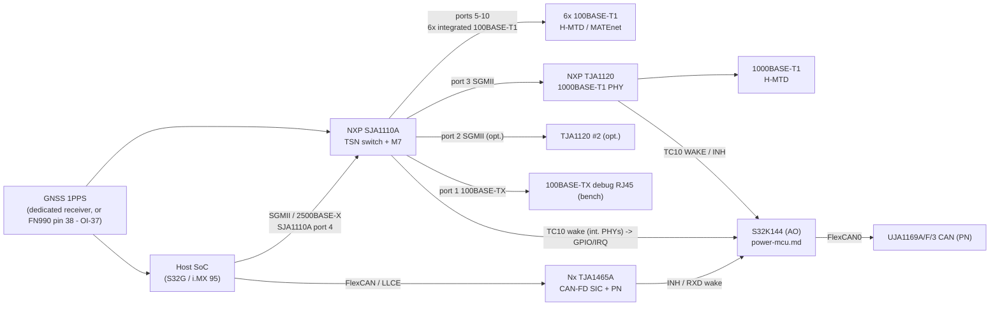

# Vehicle networking - design (issue #4)

Status: **design proposal, spin 2 (or a "spin 1.5" add-on board)**; no change to the rev 0.3 carrier. Marks: [V] verified
2026-10-10 on the linked source, [U] unverified. All parts NXP (NL), TI (US), Rosenberger (DE), TE (CH/US) - no Chinese companies.

## 1. Block diagram

## 2. Parts and port counts

| Function | Part | Key data | Mark / source |
|---|---|---|---|
| TSN switch | **NXP SJA1110A** | 10 data ports + RevMII to M7: port 1 100BASE-TX or SGMII; ports 2-3 xMII/SGMII (port 3 also 2500BASE-X); port 4 SGMII/2500BASE-X; **ports 5-10 = 6x integrated 100BASE-T1**; AEC-Q100, ASIL B; 256-LFBGA 14x14; TC10 wake; Linux DSA `sja1105` driver | [V] NXP SJA1110 objective DS 0.7 + kernel doc port matrix |
| Smaller switch | SJA1110B (5x T1) / C, D (3x T1) | if port count is lower | [V] same |
| 1000BASE-T1 PHY | **NXP TJA1120** | TC10 sleep/wake, pin-compatible with TJA1103 (per NXP) | [U] carried from issue draft; host interface SGMII/RGMII per variant [U] |
| CAN-FD with selective wake | **NXP TJA1465A** (SO14 / HVSON14) | CAN SIC up to 8 Mbit/s, ISO 11898-2:2024 selective wake (WUF), CAN FD/XL passive, INH output powers the node down, Sleep ICC <= 3 µA (<85 °C), AEC-Q100 Grade 1, ASIL B | [V] TJA1465 DS Rev 1.0 / product page |
| CAN on the AO MCU | UJA1169ATK/F/3 (SBC, PN variant) | see power-mcu.md | [V] |
| T1 connector (Rosenberger) | **H-MTD E6S20A-40MT5-y** single-port right-angle PCB plug (SMD pin-in-paste), suffix = coding/colour (e.g. -Z water blue, -A black, -B white) | 1000BASE-T1 capable | [V] Rosenberger catalogue / product pages |
| T1 connector (TE) | **MATEnet 2304372-1** (1-port, 90° horizontal, shielded header) / **2-2308956-1** (1-port vertical, sealable) | 1000BASE-T1 capable | [V] te.com product pages |
| Common-mode choke / ESD | per NXP TJA1120 / SJA1110 app notes (TDK/Murata automotive CMCs) | | [U] |

Default port plan (placeholder until I decide): **6x 100BASE-T1** (SJA1110A internal), **1-2x 1000BASE-T1** (TJA1120),
**1x 100BASE-TX** debug, **2.5G uplink** to host; **CAN-FD: 3 channels** (architecture.md said 5) with TJA1465A, at least one
with selective wake.

## 3. Wake routing (TC10 / CAN) to the always-on MCU

| Source | Signal | Into | Behaviour |
|---|---|---|---|
| 100BASE-T1 ports (SJA1110A internal PHYs) | TC10 wake-up detected -> SJA1110 wake/IRQ output | MCU GPIO (wake-capable) | MCU leaves VLPS, powers infrastructure, host |
| 1000BASE-T1 (TJA1120) | WAKE_IN_OUT / INH | MCU GPIO + SBC WAKE | same; the PHY's INH can also switch its own supply [U: pin names] |
| CAN (TJA1465A) | INH (high on wake) and RXD low | MCU GPIO; INH can enable the AO branch directly | selective wake = only configured CAN ID wakes |
| CAN (UJA1169A on MCU) | SBC wake event -> RSTN/INTN | MCU | SBC owns the MCU supply in Sleep |

For the switch to detect TC10 while parked, the SJA1110A (or at least the wake-capable PHY domain) must stay powered in PARK
-> large current [U: SJA1110 sleep current not found]. Alternative: only TJA1120/TJA1465 (low-power wake-capable parts) stay alive
in PARK; 100BASE-T1 internal ports do not wake. **Decision needed** (which ports must wake the module).

## 4. gPTP / 1PPS options (OI-37)

| Option | 1PPS source | Accuracy | Cost / impact | Mark |
|---|---|---|---|---|
| A (recommended) | **Dedicated GNSS receiver** (u-blox, Switzerland; ZED-X20K class, or NEO-M9V cost-down) 1PPS -> SJA1110 / host PHC timestamp input | timing-grade, independent of modem state | +1 module, +1 GNSS antenna | [U] part status per parts-shortlist.md |
| B | **FN990 pin 38 1PPS** (1.8 V) via Telit-only DNP + level shifter (OI-37) | unknown [U] | only when a Telit card is fitted; must never connect with Sierra (pin 38 = optional VCC) | [V] FN990 HDG pin table |
| C | No GNSS; gPTP slave to a vehicle grandmaster | n/a | none | - |

Linux flow: `ptp4l` on the switch/host PHC, `ts2phc` for the 1PPS input, `phc2sys` to system clock.

## 5. Placement decision

The FRDM-IMX95 riser path has no SGMII; i.MX 95 15x15 has no 10G SerDes on FRDM [U]. Recommendation: **spin 2 only** (S32G or
MCM-iMX95 host), with bench work on an NXP SJA1110 evaluation board in the meantime [U: EVB name/availability].

## 6. Schematic impact (spin 2)

New sheets `ethernet.kicad_sch` (SJA1110A, TJA1120, CMCs, connectors), `can.kicad_sch` (TJA1465A x N), wake lines to the MCU,
1PPS routing, SGMII to the host connector (host-interface.md option A needs extra pins or a second connector).
